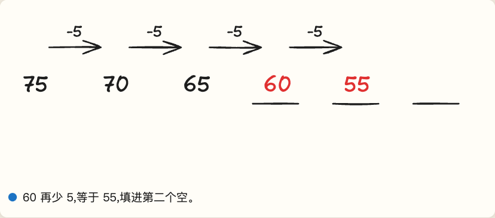

# cotutor 家长手册

> 给只想用、不改代码的家长。装好、建一个孩子的老师团、在页面上把老师配好、iPad 上给孩子用。命令只有五条,其余都在浏览器里点。改代码的看《开发者手册.md》。

## 1. 装

需要四样:

- **Node**(≥ 22.18):<https://nodejs.org> 装 LTS 版。
- **Qwen Code**:`npm i -g @qwen-code/qwen-code`,需要 0.25 或更新版本。脑模型通过它生成讲稿和板书;实时模型负责听说。
- **阿里云百炼**:老师开口、听孩子说话用的是百炼的实时语音模型。要「按量付费」的 API key 和业务空间 id,都在百炼控制台里拿(千问 Token Plan 的 `sk-sp-` 开头的 key 没有实时模型)。装好以后在家长端填(第 2 章);没配孩子端打不开。
- **cotutor**:`npm i -g cotutor`。

可选:**voxtell**(卡上的声音:点读卡、单词卡,不装这两样不出声)、**mkcert**(iPad 上按住说话要 HTTPS,`brew install mkcert && mkcert -install`,见 3.5)。

## 2. 建老师团

```sh
cotutor init ming --name 小明
cotutor doctor
cotutor serve
```

第一条在 `~/cotutor/ming/` 建一个孩子的老师团(孩子端标题是「小明的老师们」):三位老师(数学、语文、英语)、账本、对话目录、一份 `cotutor.json`。第二条逐项体检,不过的每条都带修复命令。第三条起服务,打印三个网址:孩子端 `/`,家长端 `/parent`(你日常进的),工作台 `/dev`(调设置、查原因)。

然后**配百炼**:在这台电脑上打开家长端 `/parent`,上面切到「首页」,右栏最上面一块「百炼 · 老师开口用的」,填按量的 key 和业务空间 id,点保存——先真连一次,通了才存。存在这台电脑的 `~/.config/cotutor/bailian.json`(几个孩子共用一份,不进 workspace)。没配之前孩子端首页的老师都灰着,写「老师们还没到 · 叫爸爸妈妈来看一下」,家长端「记录」顶上也有一行叫你去配。想在 iPad 上配,先用 `cotutor pin` 设家长密码(第 5 章开头):没设密码时局域网里谁都进得了家长端,不让别的设备往这台电脑写 key。

`~/cotutor/ming/` 里全是你家的数据,建议 `git init` 一下,改坏了能回退。

不想先花钱就看看孩子端长什么样:`cotutor mock` 起一份模拟接口,板书、卡、舞台都能点,不经真实老师,也不需要先 init。

## 3. 孩子端 `/`:首页与老师页

iPad 或任何浏览器打开。孩子先看到的是**首页**:每位老师一张牌,叠成一叠:手机上竖着叠,后面的老师在上面露出头像和名字;iPad 上横着叠,后面的在左边露出头像。最上面那张整张露出来,牌上是几个按钮;点后面那张,它抽出来换到最上面。一进来最上面的是你排首页时排第一的老师。你给哪位老师排了按钮或卡、孩子还没找过他,他的头像左上角有个橙点。你排的卡写在哪位老师卡后面,就在那位老师的牌里;写在所有老师卡前面的,放在牌堆上面,谁在最上面都看得到。页面上只有这些,没有别的。

> 想先看看长什么样:`cotutor mock`(不花钱、不需要 workspace,自己开来点)。

老师卡上的按钮就是进老师的门:

- **✨ 新话题**:每位老师都有,永远是第一个。点了是空白的老师页,等孩子开口。
- 牌上没有「接着刚才的」:每个按钮进去都是新话题。今天从同一个按钮聊过的,进去以后接——点「新话题」,空白板上有一个胶囊「↻ 接着刚才的:鼓励怎么写」,点了回到那个话题;点你说我画、看图说话这类 activity 按钮或小课堂,先问「接着刚才那个」还是「重新开始」(只在今天点过同一个时问)。隔天的从老师页右上角「更多 › 以前的」看,或你在首页排一个「接着」按钮。
- **▶ 开场**(比如「我要预习小蝌蚪找妈妈」)与 **↻ 接着**(比如「接着写看图写话」):是你排首页时定的(5.4「排明天的首页」)。孩子一点,老师页打开,按钮上的字立刻发给老师,老师照你们商量好的讲法开讲;「接着」以前某天的话题,老师会拿到那天最后一节讲到哪、板上有什么。

你还没排过首页(刚装好就是这样),首页就是每位老师只有「新话题」(语文老师另有常驻的「拍照听写」),别的什么都没有。

点进去就是这位老师的**老师页**。iPad 横屏:左边贴着屏幕边一整张白纸,上面是孩子刚说的那句(蓝字)和老师正在说的那句,下面一颗大按钮——老师的头像就在按钮里,按住它说话;最底下画板、拍照、相册、打字四颗小钮(画板见下面「孩子的画」)。右边铺满的是**板**,老师边讲边在上面写。竖屏和手机上没有左边那张纸:老师那句字幕在输入条上面,输入条照着孩子熟悉的聊天软件做(**相机 | 发消息或按住说话 | 加号(相册)**)。

### 3.1 老师怎么讲

- **松手 3–5 秒就开口**:孩子按住问完一松手,老师 3–5 秒就讲正事(不先垫一句「好,我讲给你听」;等的时候头像在想)。拍了照片要多等一会儿(读图 15–30 秒),老师先说一句「我看一看图片」。
- **嘴和脑**:出声的是百炼的实时语音模型(**嘴**,`qwen3.8-omni-flash-realtime`);讲什么是老师命令行定的(**脑**,老师文件、技能、你的 vault 照旧),嘴只照着脑写的念,不自己讲。
- **边讲边写**:板是老师写的笔记和练习,卡写好一张铺一张。新的一件事老师写一行标题起一**节**,还是这件事就接着往下写;孩子的话不上板;随口一问(「1 加 1 等于几」)板上不多东西。卡上要紧的词画着标注——正在定义的词绿底、公式和要记住的一句荧光黄、关键数字橙色下划线、选项紫框、标题里的词画圈。
- **末句是问句就停下**,等孩子回答:按住说或打字。不会就说「不知道」,老师会换个法子接着讲。老师在说的时候孩子按住说话 = 打断,老师马上停。
- **孩子的画**:左栏的「画板」(手机在「＋」里)是一张随手画的纸,一个话题一张,关了再开还在。画的时候按住左下角老师的小头像说话,老师看着画接一句,不打断他去讲课;他画一阵、换颜色、停下来时,老师偶尔也会看着画说一句、问一句(一张最多四句,他不理就不说了)。画好了点「给老师看」交上去,按住它说话就是画和这句话一起给老师;老师要看图,回答要等十几二十秒。交过的画在板上是一张画卡,点「接着画」回到那张纸(《画板设计.md》)。
- **再听一遍**:老师讲完,字幕下面有一行小字「再听一遍」(手机是字幕右边一颗小钮)。孩子没听进去、要按住说「我不懂」时,你可以先点它,把老师这一轮说的从头再放一遍(放着时点「停」,或孩子一按住说话就停)。
- **看按钮就知道谁在说**:老师说话时头像旁有三道淡淡的小弧「)))」,声音大一点就深一点;孩子按着时整块变蓝,一根根竖条往老师头像里走(高低跟他的声音,按着没出声会提示「我还没听到声音」);老师在想时按钮变灰、头像转圈,这时按了会晃一下说「老师在想,等一下再说」。卡在念、「再听一遍」、小课堂在放的时候按钮不画声音——那不是老师在跟他说话。按钮离屏幕底边有一大截,平板横放在桌上手指也不会碰到系统的底部手势。
- **开场**:刚进老师页、还没说话时,老师的开场(「想问什么?」)在左边白纸上;今天聊过的「接着刚才的」、点过同一个按钮的「接着刚才那个 / 重新开始」、口语单拍好的「先热身,再打电话」都跟在它下面,板是一张干净的纸。要孩子先点一个的时候,大按钮灰着写「点上面开始」。手机上开场那句在输入条上面那行,选择在它上面。
- **左撇子**:工作台「设置」里「孩子端 · 惯用手」选左撇子,白纸挪到右边、按钮里的头像在右头(孩子回首页再进老师页就变)。按钮各种样子都在工作台「工具」里的「按钮样张」一页(声音是模拟的),孩子用几天觉得哪里太吵、太淡,改动画前后在那一页比。

卡按颜色分角色:蓝是定义与结论,绿是方法,米色是事实与例子,紫是要孩子做的题,深色是封面,白底是公式与图;颜色的值在第 6 章说的主题文件里,能改。平板上字少的卡占半行,相邻两张字少的并排;手机上多数一行一张。

### 3.2 点一张卡,进舞台

点板上任何一张能做的卡,它会放大成**舞台**盖住板(老师接着说,开舞台是看卡,不算插话)。想问某张卡,点开它再按住说,老师知道问的是哪张:

选完、填完、画完,点「交给老师」,老师下一节口头说对不对。**卡上永远不画对错**——对错只在老师嘴里。孩子做过的选择和填的字存在自家电脑上,重开页面还在。

卡上没有喇叭;朗读卡、单词卡还是点了就念(声音是这张卡自己的)。老师讲稿里放小课堂的一段时,舞台自己打开放那一段,放完老师接着讲。

### 3.3 卡的种类

| 卡 | 孩子看到什么 |
|---|---|
| 一段字 | 标题卡、要点、公式、一步一步;只看不动 |
| 点读 | 一段一段的文言或课文,点一下念这一段(老师配了音色就是她的声音) |
| 选择题 | 点开是大按钮,选完交给老师 |
| 图片 | 点开能放大、双指缩放 |
| 小课堂 | 老师放你做好的小课堂里的一段,带课里的声音(见第 4 章) |
| 画板 | 孩子自己在上面画:点开铺满整屏,笔、橡皮、黑红蓝三色、撤销、清空(点两下;清空前那一版自动存一张图),老师画的底图是灰的;左下角老师的小头像按住能边画边说,老师看着画接一句;点「给老师看」把画交上去,按住它说话就是画和这句话一起交,卡上就变成这张画 |
| 田字格 | 一到四个字,一字一格,讲到时逐笔写一遍;孩子点哪个字,哪个字再写一遍 |
| 画图 | 「你说我画」里画家画的连环画:画好前是分好的几幅和「画家在画」,画好了图淡入;出题时还有题干和词语宝库(见 3.12) |
| 代码 | 原样的一段文字 |

用哪几种、一节放几张,是老师自己判断的。随口一问就只有一两句话,没有卡。

### 3.4 孩子那边永远没有的东西

没有报错、没有评判、没有工具日志、没有你们家长的对话,也**没有通往家长端的入口**。

孩子每天能问多少条、画多少张都不限;今天问了几轮、画了几张,在工作台概览上数。孩子端开在哪几台设备上、页面有没有出过错,也在工作台概览(设备卡点名字能起名,比如「Ray 的 iPad」);孩子那边照旧什么都不显示。服务没开是整叠牌变灰,不会弹任何错。

### 3.5 iPad / iPhone 上要先做一次

按住说话要 HTTPS,所以第一次要给这台 Mac 签一张证书,再让平板或手机信任它。在 Mac 上:

```sh
cotutor cert
```

它给这台 Mac 签一张证书(放在 `~/.config/cotutor/certs/`,几个孩子共用一张,Wi-Fi 换了 IP 就再跑一次),并打印 `rootCA.pem` 的位置。把这个文件隔空投送到设备上装好,**再到 设置 › 通用 › 关于本机 › 证书信任设置 里把它的开关打开**(装了不等于信任,这一步最容易漏,而且每台设备各做一次)。然后重启 `cotutor serve`,它会打印一行「扫码页」(`https://localhost:<端口>/qr`,在这台 Mac 上打开;`cotutor serve --open-qr` 顺手打开,工作台 `/dev` 右上角也有「扫码打开」):用设备的相机扫屏幕上的二维码就进去了,不用输地址;⌘P 打印出来可以贴在书桌上。个别设备扫完一直转圈(主机名解析到了走不通的 IPv6 地址),就点页面最下面的「换数字地址这张」再扫一次。

**加到主屏幕(全屏)**:在 Safari 里打开孩子端之后,点顶部的分享按钮 → **添加到主屏幕** → 添加。以后从桌面那个图标进来就是全屏的,没有地址栏也没有工具栏,孩子按不到别的网页,地址也不用再输第二次。图标是应用自己画的一张橙色小卡片,名字取 cotutor.json 里的 `title`;改了 `title` 之后删掉重加一次才会变。

分设备的完整步骤、要重做的时机、报错对照表在《iPad与iPhone.md》。

### 3.6 老师的声音

老师有两样声音,都在工作台 `/dev` 顶栏「音色」页挑,页头切换:

- **实时的嘴**:老师开口讲课的声音,百炼实时模型自己的 56 个音色(没有童声;方言、外国口音的不适合教课)。出厂语文老师 Serena、数学老师 Andre、英语老师 Theo Calm,别的老师缺省 Serena。「给谁挑」选老师,试听是真让嘴念一句(几分钱,同一句同一个音色只念一次),挑中的写进 `cotutor.json` 的 `live.voices`,「清掉」回到缺省。写错了名字 `cotutor doctor` 的 `live.voices` 会提示——不然嘴一开口就报错,孩子那边一直不出声。
- **卡的配音**:点读卡每一段、单词卡(要装 voxtell)。列出全部音色(近六百个,能按名字、特质、场景搜,按性别、年龄筛),「试听」是真合成一句(同一句同一个音色只花一次钱),听中了点「给 X 用」写进这位老师(`tutors.<老师>.voice`);右上「给谁挑」换老师,上面那行常驻这位老师现在用的是哪个、能「清掉」。老师团页里每位老师的「音色」框旁也有「去挑」。没配就没有这些声音。

### 3.7 按住说话

- 手感照着孩子熟悉的聊天软件:**按住**大按钮(手机上是输入条)0.15 秒开始听(轻点是打字),**松手就发**出去,不用再确认;按着的时候停下来想一想不要紧,手不松就一直在听;说到一半不想发了,手指**往上滑**一下再松开就取消。
- 按着的时候声音一边说一边传给嘴,嘴听懂了交给老师;不经过浏览器的语音识别。数学口语(「八加五」「三分之二」)、中英夹杂、童声都比浏览器认得准。
- 每次通话老师和孩子两边的声音录在这台电脑的 workspace 里,只给你在家长端录像里听,孩子和老师都拿不到。声音实时传到阿里云,按百炼实时模型的用量计费,价格看百炼控制台。
- 四个前提:百炼配好(第 2 章)、HTTPS(3.5 那一步)、第一次要允许麦克风、浏览器能录音。百炼没配,孩子端首页灰着写「老师们还没到」;后三样缺一样,没有按住说话、只剩打字,页面上不会报错。
- **连不上、断了**(网、百炼欠费):孩子那边老师灰着写「正在叫老师」,自己隔一会儿再连(2、4、8… 秒,最长 30 秒);这时打的字、首页按钮的开场排着,连上就发。不报错,也没有不出声只能打字的退路。
- **一直听**(试验):口语课总是一直听。别的老师缺省按住说话,孩子页上没有开关——试过一晚,孩子想一下停住、说一声「老师」、旁边大人的话,都被当成一句交给老师,孩子一句话说不完整。真要试,在 `cotutor.json` 的 `live.listen` 写 `"open"`。开着时不用按住说话,麦一直开着:孩子张嘴老师就听,停一下就算说完,老师接着说;老师说话时也在听,孩子直接插嘴,老师先小声,认出是孩子在说就停(咳嗽、「嗯」、老师自己从喇叭漏回来的声音不算,老师接着讲)。输入条右边多一个麦克风:点一下关麦(你和孩子说话、不想让老师听时用),再点开。旁边大人说话也会被当成孩子在说,要聊别的先关麦。一直听时声音一直传到阿里云(它要听才知道孩子开没开口),录像里也是整段;屏幕会锁的话先把 iPad 的自动锁定设成「永不」。两个旋钮:`live.silenceMs` 孩子停多久算说完(缺省 1600 毫秒;孩子一句话中间停顿长、老师常抢话就调大),`live.vad` 谁判说完(缺省 `"server_vad"` 按静音,「好的」「Yes」这类一两个字的回答也听得见,代价是「嗯」、笑声会让老师小声一下;换成 `"semantic_vad"` 按语义,不理「嗯」和笑声,但一两个字的回答听不见)。改了下次进老师页生效。

### 3.8 新话题与以前的

老师页没有顶栏:左上角一颗「‹ logo 语」的胶囊(cotutor 的双 C,和首页标题前那颗一样;整颗填这位老师的颜色,后面是他的首字,同首页牌上那块小牌),点它回首页(浏览器的后退、iPad 左边缘右滑在孩子端里不起作用,免得孩子一滑就离开老师页;回首页只认这颗);老师的头像在左边白纸的大按钮里(手机在字幕那行开头),说话、想、听的时候它会动;右上角是「更多」。语文、数学、英语老师的板右边竖着一个很淡的学科名,像课本的书脊,字照课本封面(语文是毛笔字、数学是粗宋、英语是 ENGLISH),卡铺上来就盖住它;别的老师的板是空的。空白的老师页不写这是哪位老师,看胶囊。看以前的话题、接着哪天的话题时,胶囊旁边有一枚小标签说明现在在哪。听写、口语课、小课堂里左上角是同一颗胶囊,颜色和首字是念的那位老师。

从首页进老师页时,话题由点的按钮定(见 3 章开头);进来之后点右上角「更多」,弹出带说明的两项:

- **✨ 新话题**:板书清空,出一句「换个话题吧,想问什么?」。这时什么都还没发生,孩子说出第一句话老师才真的新开一个会话——不带上刚才的板书,也不接着刚才的上下文(老师的记忆和账本照旧在,不是失忆)。回首页或点「以前的」就当没按过。老师还在想的时候按不了。
- **🕓 以前的**:按天列出这位老师的话题(今天、昨天、几月几日),每行是孩子当时的第一句话、时间、几节几张卡。点**今天的**旧话题回到那一页,可以接着聊,老师会接上那个话题的会话;点**以前几天的**只能看:板上是当时写的,卡能点开看当时选的、填的,不能改,底下一颗「回到今天」。列表拉最近 30 天。

工作台 `/dev` 对话页里,一天有多个话题时每条消息标「话题 <id>」,话题之间有分隔线;发消息旁的话题下拉选「＋ 新话题」就是替孩子新开一个。家长端 `/parent` 的清单本来就是按话题列的。终端 `cotutor send <老师> "<话>" --new` 同样。

### 3.9 拍作业

在哪位老师的页上拍,照片就直接给谁——数学作业就在数学老师页拍,不用先经过谁认学科;首页不能拍。输入条左边的相机是直接拍,右边「＋」里有「相册」和「拍照」。拍照一次一张,相册一次最多选 4 张(一份作业的几页一起发)。拿起相机老师就先停下。

拍完、选完先到**发照片屏**,不会马上发出去:
- **裁剪**:拖四个角、拖框平移,「整张」还原,「好了」收下。去掉桌面、只留那道题。
- **圈画**:一支半透明的红笔,「撤销」「清空」。圈出问的是哪道——老师会先讲圈住的那道。
- **转 90°**:拍歪了转正,已经圈的、裁的跟着转。
- 几张时下面有缩略图条,点一张切过去改它,角上 × 去掉那张。

「发给老师」:发出去的是改过的样子(裁过、带红圈),原图不另存;几张照片是同一条消息,老师那边看到的是「(拍了 N 张)」,想说什么发完再按住说。传到一半断了,发照片屏不关、改过的都在,再点一次就行。「取消」什么都不发。

老师自己看图认题:第一句会说认出是哪本、哪页、哪道,板书上第一张卡就是原图(或抄下来的题面),一页好几道会列题号问孩子讲哪道。要孩子在自己的作业上圈错题、写答案时,老师会出一张以照片为底的画板卡,点开就能在照片上画,「给老师看」交回去。拍糊了、拍不全,老师会在讲稿里让孩子再拍一张。

照片存在 workspace 的 `captures/<日期>/` 里(不进 Obsidian 仓库,不进 git);晚上记账时日记里只写老师认出的文字——册子、页、题号、题面——不会有照片路径。想看发出去的图去家长端。照片在设备里按原分辨率裁、画,最后缩到长边 2000 再传,一张几百 KB 到一兆出头。

### 3.10 口语课(试验):孩子拍一张今天学的,先热身、再和英语老师用英语打电话

出厂关着,开法:`cotutor.json` 里加 `"talk": { "enabled": true }`(存了就生效)。开了以后,英语老师卡上自动多一个「口语课」(对话气泡「Hi」带相机);不想要就在家长端「首页」的「每天都在」里关掉。全程在孩子的 iPad 上,你帮着拍也是走这条路:

1. **拍**:点「口语课」先到拍照屏,拍课本上今天学的那页(或从相册选)。老师把印刷的单词和句子读出来,各带中文——这叫**口语单**;单词顺手配好单词卡要的 emoji 和自然拼读分段。读的时候照片在左边、右边写「老师在看这一页…」,读完原地填上。印刷体读得准,手写的先别拍。
2. **看一眼、改一改**:照片在左对照着看。点一项能改英文和中文,× 去掉,能补一个单词、补一句;这一页没读出英文就换一页拍,或者自己补几个。上次拍过的,拍照屏最上面有「接着上」,用最近那份口语单直接开始。
3. **先热身,再打电话**:点了进英语老师的老师页,孩子再点一下开始(这一下起声音),不用按、一直听。
   - **热身**:老师用中文带,一拍一拍地跟读——「我说一个英文,你学一个,像回声」、小声说、大声说、长句从后往前一截一截搭,最后一两个「你先说」。老师念完一拍,那张卡边上一圈慢慢呼吸的光,就是轮到他了;他跟了老师就接下一拍,8 秒没开口老师也接着走,不催、不说读得好不好。他说「不想读」「直接打电话吧」,老师就收掉热身。热身同时是**摸底**:应用记下每拍跟没跟、说出了哪些词、自己说不说得出(只看字,不管发音)。
   - **打电话**:热身完了响铃,老师改说英文,一问一答,问题照摸底挑他答得上的,板上配一张写着这个句型的卡(他要说的词留空);他答中文,老师用英文说一遍再请他说;他说「听不懂」才夹半句中文。到点(`talk.minutes`,从响铃算)老师说再见。
4. **看回放**(你在家长端):记录里是英语老师的一个话题(热身和打电话一份录像),老师在给你的话里写一两句摸底。

**给老师的话**与**聊几分钟**在家长端「首页」的口语课那行里(也就是 `talk` 的 `note`、`minutes`):写「这周学颜色和玩具,多问他喜欢什么颜色的车」,热身和打电话的时候老师都照着做,孩子看不到。存了就生效。打电话那段英语老师用 qwen3.8-max 比 qwen-flash 稳(flash 常常不问问题),`cotutor.json` 的 `tutors.english-tutor.runtime` 写 `qwen`。

照片和口语单在 workspace 的 `talk/<日期-时分>/`,上课那段在英语老师的对话里。声音实时传到阿里云。

### 3.11 听写:老师念,孩子用 Apple Pencil 在田字格里写

有两种开法。

**拍照听写**(在语文老师的卡里,「每天都在」下面):在 iPad 上点「拍照听写」,拍课本上的词语、写字,或者老师发的听写单。认出来的字词一个一个框在照片上,蓝框是会念的,点一下框就选上或去掉;橙框是没认准的,右边列表里能改字。点「开始听写」就开始。你拿孩子的 iPad 拍好交给他,或者他自己拍,都行。

- 模型把照片上的正文一行一行全认出来,再挑出要会写的字词:「写字」「词语」「读读写写」、课文里课本自己框出来或划线的、听写单上的,默认选上;「识字」栏的挑出来但不选(虚线框)。
- 右边列表下面是**照片上的全文**,分好了词,点一个词就加进来(再点一下去掉);想念的词照片上没有,在「自己加词」框里打,空格分开。一次最多 20 个。
- 认字用百炼的 qwen3.8-max(和语文老师同一个 key),挑的词先一项一项出来,几秒就有;整张认完十几秒。
- **挑词的要求在 `agents/chinese-tutor/activities/听写.md` 的「认字收到什么」里**,一行一条,改了存上就生效,不用重起服务。比如只想听写写字栏的字,就把「课文里标出来的」那行改成「不挑」。`{{格式}}` 那行别删:回答的格式由应用填。这份文件还写着听写怎么走、孩子看到什么、记在哪,打开就能看懂。`dictation.model` 是用哪个模型认。
- 照片存在 workspace 的 `dictation/photos/`。
- 哪位老师卡上有听写,看 `cotutor.json` 那位老师的 `extras`:没写时语文老师有,别的没有;写了 `"extras": []` 就都不要,写了 `["dictation"]` 就有(用他的声音念)。

**首页的听写卡**:一行一个词。排首页时跟编程助手说「明天听写这几个词」,或者直接写进 `home/draft.md`,再发布:

````markdown
```dictation chinese-tutor
春天
鼓励 鼓励,老师鼓励我的鼓励
叶 树叶的叶
```
````

- 词后面空一格写**念法**。孩子听到的就是这一句,念两遍。同音字、单个字最好写上念法。
- `chinese-tutor` 是谁的声音,可以不写。写了、那位老师卡上又有听写,这张卡就放进他的卡里(「每天都在」下面),不单独铺在首页上。
- 只认汉字,一个词最多四个字,一张卡最多 20 个词。

孩子那边:

1. 首页上一张「听写 · 3 个词」,看不到字。点开,老师念一个词,念两遍。
2. 左边是**听写本**:一个词一行,几个字几个小格,写过的字缩在里面。右边是一个大格,一次写一个字;写好点「写好了」,跳到下一个字,这个词写完就念下一个。点听写本上这个词的小格,能回去改。
3. 想不起来,点「**不会写,给答案**」:书上的字在大格里一笔一笔写给他看(可以再看一遍);放完或者他一落笔,就换成灰色描红打底,他必须照着写一遍才能往下走。这个字记作「看了答案」。
4. 全写完,书上的字淡淡叠在他写的字上,他自己对。点一个字,书上的字就在他写的上面一笔一笔写一遍。
5. 少写了笔、多写了笔、写成别的字、空着的词,卡上问一句「这个再写一遍?」。没有叉,没有分数。看过答案的词已经照着写过,不再问。
6. 笔顺不对、写偏写小,孩子那边不提。

**英文单词听写**(英语老师卡上):听写卡里写英文单词(一行一个,`dictation english-tutor`),或者在家长端「首页」给英语老师设这周的词(能一键用口语单上的单词);英语老师卡上开了听写,还有拍照听写(认课本上的英文单词,要求在 `agents/english-tutor/activities/听写.md` 的「认字收到什么」)。孩子那边一个单词一个四线三格,写整个单词;不会写点「给答案」,单词灰灰地打底照着描。全写完交上去,书上的单词淡淡叠在他写的上面,**自己对**——不逐个字母比,不问「再写一遍?」,想再写自己点。念的是英语老师卡的配音音色。

你这边:家长端「记录」里点那一行听写,就是它的录像(下面);逐字的分析在 `/parent/dictation`(录像的「经过」里也有)。每个词有第一遍和重写的并排,底下一条条写着:少了第几笔、多了几笔、写的先后、哪一笔写反了方向、写得偏不偏、擦过几次。还会记下他是被问了才改、自己改的,还是看了答案。最后一栏「要再练的词」(看了答案的、没写全的、重写过的),复制进下次的首页草稿就行。

**看录像**:「记录」里点那一行听写(或结果页上点「看录像」),和话题的录像一个样子:上半是孩子当时的写字屏,一笔一笔重画,给答案后的笔顺、描红、擦掉的笔(擦的那一刻消失)、对一对、再写一遍都在;下半是同一条录像栏,一个词一章,点是给答案、擦掉、切到别处,一进来停在最后(对一对那一屏)。「经过」里一条条写着念了几遍、写「肚」7 笔用了 4 秒、停了 9 秒一笔没写、点了给答案,还有每个词写好那一刻的比对(少了第几笔、可能写成了别的字、笔顺、写得偏不偏)。可以 2 倍、4 倍;录的是笔迹与时刻,不录屏幕、不录孩子的声音,放到念的那一刻放老师念的那一句。

几件该知道的:

- 判对错是拿他写的每一笔去比字库里每一笔的走向,不经大模型,不花钱。笔画一样、只差长短的字分不出来,比如土和士、己和已。
- 用手指也能写,但用过 Apple Pencil 之后,手掌碰到屏幕不算一笔。
- 中途回了首页,再点进来接着写。同一张卡当天写完了还能「再听写一次」。
- 念的老师没配卡的配音音色(3.6),孩子那边不让开始,直接写「老师的声音还没配好 · 叫爸爸妈妈来看一下」;配了但某个词合成失败,念到它时也写这一句。不念浏览器自带的声音。
- 记录在 workspace 的 `dictation/` 里,一次一个文件,照片在 `dictation/photos/`;都不进 git,也不写 Obsidian。

### 3.12 你说我画:孩子说清楚一个故事,画家照着画

孩子编一个故事,语文老师一问一答帮他说清楚,画家(百炼的文生图模型)照着画成一张四格连环画,像练习册上看图说话的图。图是奖励,要教的是**把一件事说清楚**:谁、在哪、什么时候,先后,每一幅看得见在干什么,前后对得上,说得通,结果和心情。

- 老师用「画家想知道……」来问,不说「你没说清楚」。前后对不上,把他说过的两句并排问「画家画哪个」;不合常理问「中间过了多久」,他说是魔法也算,请他在开头交代一句;说「很高兴」就问画家怎么画出来。只问不改。
- 七件事都齐了、他看着整段连着说过一遍,老师才写画图卡。他催着画,老师说「画家还想知道一件事」。
- 画大约十几秒。画好了老师看不到图,只问他哪里和想的一样、哪里不一样;想改就改那一句,再画一张。一个话题最多两张。
- **我来出题**:按钮下面写上这周学的词(`词:`),孩子就是出题人——挑三四个词编故事,每个词落到一幅上(「羞愧」画成低着头、脸红红的),再说要问看图的人什么。画出来就是一道看图说话题:题干、四格图、词语宝库,拿去考你。

**怎么开**:在首页给语文老师加两个 activity 按钮(在 workspace 里和编程助手说「给语文老师加你说我画」就行):

```tutor chinese-tutor
activity 你说我画
activity 你说我画 我来出题
词: 播种、睡大觉、满满、一筐、羞愧
```

- 「你说我画」话题里的老师不读语文老师文件:人设、做法、用哪几种卡,都在 `agents/chinese-tutor/activities/你说我画.md`;它记的东西也单独一篇,在 vault 的 `记忆/语文老师·你说我画.md`,要语文老师也知道,自己复制过去。
- 「你说我画」怎么带,整个写在 `agents/chinese-tutor/activities/你说我画.md` 里:你要填什么(「## 家长填的」:`词` 可以不填,`最多画` 不填就不限)、应用替你算什么、应用替你拦什么、老师怎么带、交给画家的那段话。想改它的做法,改这个文件,改完跑 `cotutor activity check chinese-tutor 你说我画`;也可以在电脑上开工作台 `/dev` 的「activity」页改,边改边查,还能看老师实际收到什么。改坏了的 activity,孩子首页上它的按钮先不出,改好就回来。
- `词:` 写了就是「我来出题」,不写就是只编故事。孩子点的那一刻用的是那时的词;你后来改了,已经开始的那个故事不变。
- `讲法:` 照旧能挂在按钮下面,写这一次要注意的。
- 老 workspace:`cotutor upgrade` 会补上这个文件。语文老师文件你改过的,里面那节「你说我画」还在(upgrade 只报 diff),doctor 会提醒你删掉,免得两处说法不一样。语文老师的 `cards` 里不用再写 `paint`,画图卡跟着这个 activity 走。
- 要百炼 key(和 qwen 老师同一份,见第 6 章「让某位老师用 Qwen」第 1 步)。孩子说的话不直接给画图模型,给的是老师写的分幅(只写看得见的)和画风。
- `cotutor.json` 的 `paint`:一天画几张不限,今天画了几张在工作台概览上数;`model` 用哪个模型(缺省 `qwen-image-3.0-pro`,约 10–20 秒,千问 Token Plan 与百炼按量都能画;`qwen-image-2.0-pro` 约 15 秒、`qwen-image-2.0` 约 4 秒,只有百炼按量);画风不在这里:在 `agents/chinese-tutor/activities/你说我画.md` 的「画家收到什么」,改了存上就生效,`{{版式}} {{角色}} {{分幅}}` 三个插槽别删。
- 没画成(没 key、审核没过、超时),孩子那边就停在分好的几幅,不说没画成;老师请孩子看着分好的几幅自己讲一遍。按钮上设了 `最多画`、这个话题画够了,老师说「这个故事画够啦,想再画,就讲一个新故事」。原因在家长端那张卡下面一行。
- 图在 `conversations/<老师>/<日期>.<job>.cards/<第几张>/paint.png`,旁边的 `paint.json` 记着交给画家的整段话、用的模型、画了几秒。删话题一起删。

## 4. 小课堂

一步一步画出来、带老师声音的讲解,叫**小课堂**。它由你在幕后做,不由老师现做。



怎么来的:

1. 学科老师碰到「画出来才讲得清」的题(找规律、行程、面积推导这种),这一节照常用卡讲完,不让孩子等。
2. 老师觉得值得做一堂,会在给你的那段话里写一段「想要小课堂」:题面和讲法。家长端那一轮的「给家长」里看得到。
3. 你在 workspace 里开编程助手,说「把老师想要的小课堂做了」。cotutor-home 技能会找出这些请求,用 drawtell 做成课包,挂到那位老师首页的卡上。
4. 孩子从首页的「小课堂」按钮进去,从头看完才能问老师;看的时候能暂停,点「画一画」在画面上画(圈、打勾、打问号、写字都行)。停在同一刻画的几笔算一处,一堂课最多画 6 处。
5. 看完以后老师怎么聊,写在那位老师的 `agents/<老师>/activities/小课堂.md`(语文、数学、英语各一份):先接孩子的话、对着他画的地方说、道理课里讲过就放课里那一段。想改就改这份;它的记忆是单独一篇(`记忆/数学老师·小课堂.md`)。这份删了,那位老师的小课堂按钮孩子端就不出。
5. 孩子问的时候,老师拿到课里每一句和孩子画的每一处(一处一张截图:那一刻的画面加上他画的笔画),会放课里那一段给他看,不再从头讲。带了画的那一条老师要看图,开口会慢一些(二三十秒)。

几件该知道的事:

- **课包是派生物**:都在 `bundles/` 里,不进 git。做课的源在你做课的地方,别删。
- **现成的视频也能当小课堂**:放进 `lectures/<id>/`,写法问 cotutor-home。
- 2026-10-07 以前有一位画图老师,在孩子等的时候现做动画(一个 4 分钟、半美元)。它删了;老对话里的讲解动画卡现在只显示文字,放不了。

## 5. 家长端 `/parent` 与工作台 `/dev`

两页。**家长端 `/parent`** 是日常进的那页,iPad 扫码进的就是它,不懂技术也用得顺(5.1)。**工作台 `/dev`** 是装完调一次、出了问题查原因的地方(5.2–5.4),平时可以不开;有技术背景的家长和开发者去那里。

**要不要加个锁**:这两页缺省没有密码,家里 Wi-Fi 上任何设备输地址就能开——孩子用 iPad 时你在旁边、用完收回,就这样用着没问题(`cotutor doctor` 会提一句,不是错)。想锁,在电脑上跑一次 `cotutor pin`,设一个 4 到 8 位的数字:之后 iPad、手机上开 `/parent` 或 `/dev` 先输一次,这台设备 90 天内不再问;这台电脑上不用输。孩子端完全不受影响,也看不到有这回事。改 PIN 再跑 `cotutor pin`(所有设备重输),不要了 `cotutor pin off`。PIN 是这台电脑的,几个孩子的老师团共用一个。

### 5.1 家长端 `/parent`:日常进的那页

孩子学完,你拿起 iPad(或者就在电脑上)想看「今天都学了什么、老师怎么讲的、他答了什么」,开 `/parent`(iPad 上扫码,扫码页最下面有「家长那张」;加到主屏幕会是一个单独的图标,名字带「家长」;工作台右上角也有「家长端」)。

家长端分两块,顶上两个标签切:**首页**(设孩子的首页,下面「首页那一块」)和**记录**(看孩子学了什么,就是下面这些)。

打开是**这一天的时间线**,最新的在最上面,不分老师:左边是几点开始、用了几分钟,竖线上的点是老师的颜色,两件事之间隔得久会写「隔了 N 分钟」。每件事上半截就是孩子在首页上点的那一颗,和他看到的一模一样——学科色的「新话题」气泡(小字是他问的第一句)、▶ 开场或 ↻ 接着的大胶囊、小课堂的海报、听写那一条格子(格子里画着他写的字,看了答案的笔是橙色)、口语课;下半截一条是你才有的:几节几张卡(听写写着看了几个答案、再写了几个)、停在哪(「停下等孩子」「老师在写」)、记过账没有、五颗星、「删」。

顶上是**一条七天**,以今天结尾:每天下面几个彩色小点,是那天和孩子聊过的老师(颜色同老师的头像),哪天空着一眼看得出;点一天看那天,两头的 ‹ › 一次翻七天。

**这一天老师跟你说的**:iPad 横着拿时在右边,竖着拿或用手机时接在时间线后面。只放卡上没有的:这天每个话题里老师写给你的话(标着哪位老师、几点、哪件事)、记住了什么、听写里要再练的词(看了答案、重写过、被问了再写的),最后是「日记」——记了几个、还有几个没记,和那颗「记账」。

**点一件就是它的录像**,停在最后一帧:板上的东西都在,就是孩子聊完时看到的样子,不会自己放、不出声。停着的时候可以在上面上下翻(只能翻,点不动,卡是他的,不会改了他的答案);想看过程,往前拖进度条或点 ▶。孩子没开过口的话题(系统开头的、备课的)也有,只有老师那一轨。今天的话题停在最后时会跟着长:老师写了新的、孩子又说了,几秒内就接上。

录像这一页是深色底:中间那块浅色的是孩子的屏幕,左上角白色的「✕ 退出录像」回到记录(孩子屏幕里左上角那颗「‹ logo 语」是录下来的,点不动),旁边写着这是哪位老师的哪件事。孩子的屏幕和他当时在 iPad 上看到的一样:老师的字幕、板上一张张写出来的卡、他按住说话时按钮的样子、他打的字(删掉的也看得到)、弹出来的选择题、拍照的那一屏;声音是那次通话录下的,老师的嘴和他自己两边按时间对好的一条。下半是录像栏:播放键两边的 ⏮ ⏭ 是上一章 / 下一章(他每开口一次是一章,听写一个词一章)——和一般视频不一样,跳到的是那一章**讲完**的样子,不是开头:板书齐了、他在卡上做的也在,下一次开口之前。左下角是放到哪 / 一共多久,和看视频一样,下面一行小字是当时几点;进度条上的点是他开口、改卡、老师停下等他,章与章之间断开一点(他每开口一次是一轮);上面一行写这一刻屏幕上看不出来的(等了老师多久、他想了多久、嘴把他的话认成了什么)。「跳过空白」开着时,长时间的等和想压成一秒半,关了是完整版。点「经过 ▴」(或在那一行上往上拉)展开这个话题的经过,一条一行,点一条跳过去:孩子说的(按住说话的带原声几秒)、他在卡上做了什么、想了多久、选择题的**答案**、画图给你的那句、小课堂里他画的地方老师收到的那段话、老师写给你的话、记住了什么、提醒、记账,都在这里,孩子的屏幕上没有。录像栏顶上的小横条点一下(或往下拉)收成一行,只剩播放、进度条和时间。iPad 接了键盘或在 Mac 上,有快捷键:空格放 / 停,⇧← ⇧→(或 [ ])上一章 / 下一章,← → 退进 5 秒,Esc 退出,按 ? 或点右上角「快捷键」看全部;耳机、键盘上的媒体键和 iPad 控制中心的 ⏯ ⏮ ⏭ 也管用(录像在出声时)。标「画法已更新」的是旧版孩子端录的,板上的东西照旧,样子可能和他当时看到的有出入。

**按住说话没发出去**:孩子按住说话,有时话筒没开、没声音,他看到的只是「没听清,再按住说一次」,自己不知道是坏了,也说不出来。偶尔一两次不要紧;同一个话题里连着三次以上没发出去,清单上那一行会写「⚠ 按住说话连着 N 次没发出去」,录像的进度条上那一串是一条橙色的带,点进去看他当时卡在哪。

「记录」这一块**只看**:没有输入条,你不能在这里替孩子说话、做卡。每件事下面有五颗星,点了就是给这个话题打分(记账时够分的才沉淀摘要,见第 8 章);「这一天老师跟你说的」最后有「记账」(第 8 章:每个话题起老师一轮、写进日记,要花钱,所以点一下变「确定记?」再点才记;老师在写或在记时是灰的,记好了行上亮「已记账」)。每件事下面那条最右边有个「删」:点一下变成「确定删?」,三秒内再点一下才真删——板书、录音、转录整个没了,孩子那页也看不到了;这个话题里老师**记进记忆文件的、记账写进日记的,也一起撤掉**,删完弹一句撤了什么。那一条后来被你或「整理记忆」改过的,找不到就不动,也会告诉你哪条没撤成,要改去 Obsidian 里改。老师还在写的话题删不掉,等它写完。拍的作业照片不删。

**首页那一块**(`/parent/home`):一位一位老师看,改了马上发到孩子的首页(每改一次在 `home/history/` 留一份)。

- **百炼**:老师开口用的(第 2 章)。配好了是一行「配好了 · key …末四位 · 业务空间」,能「试一下」;没配时这块在右栏最上面。
- **孩子看到的首页**:左边(手机上是上面)就是孩子打开首页看到的样子,不是照着画的——几张牌怎么叠、按钮长什么样、听写那一条,都和他 iPad 上一样;右上角能切「iPad / 手机」看两种样子。点牌上的按钮就改它:按钮上的字(孩子的口吻,最多 16 个字)、讲法(写给老师的,孩子看不到)、留多久(只今天 / 到周日 / 一直留着,缺省只今天);改的时候牌上那颗跟着变,点「发布」才到孩子那边。iPad 横着拿时表单在右边,竖着拿或用手机时是整屏的表单。点后面那张牌就换到那位老师,和孩子点的时候一样会抽出来;点听写、口语课,去改这周的词、口语课的设置。牌下面:「+ 给某某老师加一个开场按钮」,一位老师最多 4 个;留到的日子过了、孩子已经看不到的按钮也列在那里,照样能改能删。编程助手排的「接着」「小课堂」按钮,这里只改字和讲法。「新话题」是应用自己加的,改不了。
- **老师的先后**:牌下面一排,一位一个,按住左右拖,排第一的那位孩子一进首页就在最前;不在首页上的淡着。拖完那位老师会抽到预览的最前。
- **每天都在**:听写、口语课开不开。听写下面是**这周的词**:一行一个词,念法空一格写后面,设了孩子点「听写」直接写;清空就不要了。口语课下面是**给老师的话**(这周学什么、想多聊什么)和聊几分钟。
- **这位老师**:在不在孩子的首页上。

这一块缺省没有密码:学习时把 iPad 交给孩子,学完拿回来就行;要锁见第 5 章开头的 `cotutor pin`。编程助手下次排首页时,会拿你在这里改过的那份当底稿。

**想试试老师现在怎么讲**(改了老师文件、在 Obsidian 里加了一节题型):打开孩子端,你当孩子,和老师聊一遍——老师拿到的和孩子拿到的一样,你听到的就是孩子听到的节奏。聊完回到这一页,把这个话题「删」掉:它写进记忆、日记的一起撤。没删之前它和孩子自己聊的一样:孩子看得到、老师会记住。(要先给孩子讲一段做好的课,用首页的「小课堂」按钮:课包或你放进 `lectures/` 的视频,孩子看完才问老师,看的过程和画的地方都在录像里,见《小课堂设计.md》。)

### 5.2 工作台 `/dev`:四个标签

四个标签(对话 / 老师团 / 音色 / 设置;音色见 3.6):

- **对话**:左边是老师,点一位就能说话。在这里发的算孩子说的(孩子那页看得到、老师会记住),试完不要了就去家长端清单上删。顶上那条钉着不动:今天几轮、花了多少、快不快。底下的输入框也钉着,不会被长内容顶走。
  **一轮就是一张卡**,从上到下:谁问的 → 老师在板上写的 → 这轮的用时与花费 → 「孩子看到」→ 出错的话。中间那块**和孩子看到的板书长得一样**:大标题、带序号的步骤、居中的公式、选择题(正确的那项标着「答案」,只有你看得见)、点读的词、图片、小课堂。讲稿按句编号,句子里老师要在卡上圈出来的词是墨绿色的,最后一句是问句会写「⏸ 停下等孩子」(中间的问句不停);老师这一问没配选择 / 填空卡时,板书最后会多一张「提问」卡,写着这句问话——应用替老师补的,孩子回头能看到老师问了什么。
  老师用了什么工具默认收着,点「转录」才展开——你平时不用看日志。想知道老师原话长什么样、孩子为什么没听到某句,点「看原文」(下面)。
  输入框下有一颗**「📷 照片」**:选一张或几张作业照片,缩略图先排在输入框上(点 × 去掉),按发送就和这句话一起给老师,和孩子在自己那页拍的是同一条路;发过的照片在那轮的问句下面,点开看原图,转录里能看到老师 Read 了哪张。
- **老师团**:**一位老师一行**。改过的设置直接挂在行上(比如「每句 40 字」),没改过的写「全部继承」——谁被你调过一眼就看出来。点一行展开:显示名、学科、头像、音色(旁边「去挑」跳到音色页听着选)、开关、孩子端露不露,还有字数这些旋钮;继承的框里是灰字「继承 30」,你写过的会亮起来。行里「改老师文件 →」跳到 activity 页这位老师的「新话题」:那就是这位老师的性子和讲法(一段中文),孩子点新话题、开场按钮聊的都照它,想让数学老师说话慢一点、多打比方,就在这里改;旁边能看老师实际收到什么、和出厂那份比、恢复出厂。**＋ 新老师**在标题栏上:填个英文名和显示名,一位新老师就有了。自家加的老师能删,出厂的只能关(关了会留在列表里变灰,随手能开回来)。
- **设置**:分三块——路径(Obsidian 仓库、课程表、计划,右边灰字是现在真正用的绝对路径)、服务(端口、证书)、卡的配音。配音那块有个**「试一句」**:按一下就合成一句放给你听,配音没配对当场就知道,不用等孩子点了卡没声音才发现。升级之后这里顶上可能出现一张「缺 N 项出厂件」的卡,见第 9 章。

右上角的「家长端」回到 5.1 那页。

### 5.3 看原文:孩子为什么没听到那句

每一轮右下角有「看原文」。点开是右边一个抽屉,把这一轮拆成七站,从上到下就是老师那句话走过的路:

1. **上下文包** — 我们真正发给老师的东西(她看到了档案、入口文件、记忆,哪些计划、哪些最近观察、孩子在卡上做了什么)。
2. **时间线** — 这一轮每道工序各花了多久;`mouth` 那一行是嘴:孩子按下、松手、老师先说的那句(只有拍照、没听清时有)、每句开始念、被打断,这一站写「松手到第一句」。
3. **老师原文** — 老师写回来的原话,每一行右边标着「这句是讲稿、要念」「这几行是一张卡」「这段是给你的、孩子看不到」。哪一行出了毛病,毛病就写在那一行下面。
4. **解析结果** — 我们从原话里读出了几张卡、几句话。
5. **下发给孩子** — 真发出去的那几句(太长被截掉的部分画着删除线,孩子听不到)、每张卡剥掉答案之后的样子、卡的配音有没有。
6. **读了什么** — 老师这轮翻了哪些文件;没翻就是只凭上下文包答的。
7. **转录与报错** — 老师用了哪些工具、出错的原因。

平时用不到。孩子说「老师讲了一半」「那张卡没出来」的时候,从上往下看一眼就知道断在哪一层。

不喜欢点页面也可以直接改 `~/cotutor/ming/cotutor.json`,编辑器会有补全和提示(文件首行指向了一份 schema);改坏了页面顶栏会红字提醒,服务仍用上一份。

### 5.4 排明天的首页

孩子学完以后,在 Mac 上打开终端,进到孩子的 workspace(如 `cd ~/cotutor/ming`),开编程助手(如 Qwen Code),说「总结一下今天,排明天的首页」。workspace 里装好了技能 `cotutor-home`,它会:

1. **看今天**:读今天每位老师的对话,也看上次的首页孩子点了什么;在对话里给你每位老师两三行总结——学了什么、停在哪、哪里卡住。总结不另存文件。
2. **问你要不要记账**:要留下来的,给话题打星、记账(第 8 章),进 Obsidian 的日记。记账每个话题要老师跑一轮,会先问你。
3. **和你商量下次**:每位老师几个按钮(孩子看到的字,如「我要预习小蝌蚪找妈妈」)、每个按钮给老师的**讲法**(从哪开始、重点、讲到哪收,孩子看不到),再加几张给孩子看的卡。每条带一句为什么,你改到满意为止。
4. **写草稿、检查**:你点头后它写 `home/draft.md`,跑 `cotutor home check`。「要改」的(比如指的话题找不到、首页放不了的卡)它会改掉;「提醒」的(比如哪位老师没写卡)会跟你说。
5. **你说「发吧」才发布**:`cotutor home publish`。孩子端刷新就是新首页,不用重起服务。

几件该知道的:

- 草稿、发布过的每一份都在 workspace 的 `home/` 里(`draft.md`、`published.json`、`history/`),不在 Obsidian。想回到以前的某份:`cotutor home publish --from home/history/<那份>.md`。
- 有「要改」的时候不会发布;实在要发,`--force` 会丢掉那几张卡或那几个按钮。
- 首页不会自己过期,几天前发布的照样显示;超过 3 天,`cotutor doctor` 会提醒你该排新的了。
- 孩子点了哪个按钮,记在那条消息上;`cotutor home show` 能看到。
- 按钮上的字不算孩子说的话,日记的「孩子问」里不会有它。
- 不想让编程助手写,也可以直接改 `home/draft.md`(写法在 workspace 的 `.claude/skills/cotutor-home/references/首页语法.md`),再 `cotutor home publish`。

## 6. 你能拧的旋钮

都在老师团页上(整体的在「全局」卡,某一位的在她自己的卡里,留空 = 跟着全局走)。

| 旋钮 | 缺省 | 管什么 |
|---|---|---|
| 单条回复字数上限 | 60 | 老师讲稿**每一句**的字数,超了在句末截断 |
| 动笔前想多久 | low(数学老师 medium) | 孩子问完到听见第一个字要等多久,主要看这个。`low` = 想得少、开口快(约 10–20 秒);`medium` = 多想一会儿,算题的老师用;`high` = 最慢最细,孩子要多等半分钟以上。老 workspace 升级后数学老师不会自己变成 medium,在她的卡里选一下 |
| 板书 | auto | `auto` = 老师自己判断要不要出卡;`off` = 这位老师只说话,不出卡 |
| 孩子的话带不带工具 | off | `off` = 孩子说的话老师只凭我们备好的上下文答,开口快;`on` = 能查教材、读 vault,慢得多(真实对话里用了工具的轮要等半分钟)。带照片的那条、记账,总是带工具。你在家长端发的话,老师也当成孩子说的。老 workspace 要先 `cotutor upgrade --config` 才生效 |
| 断流等多久 | 30 秒 | 网络偶尔会把老师的回答卡在半路。老师这么久一个字都没出来(查资料、跑工具的时候不算)就当断了,应用接着让老师从断处往下写,最多接 2 次;家长页那条会写「API 流断了几次」。只在 `cotutor.json` 里改:`policyDefaults.stall`:`ms`(缺省 30000,0 = 关掉,干等 CLI 自己约 3 分钟的重试)/ `retries`(缺省 2) |
| 讲哪几种卡 | 出厂老师各有一份 | 只在 `cotutor.json` 里改:`tutors.<老师>.cards`,比如英语老师 `["text", "read", "choice", "image", "word", "lecture"]`。老师的板书写法里只讲这几种,省得英语老师去学画板;老师写了清单外的卡照样显示,家长端那轮会提醒一句。不写 = 全部。老 workspace 用 `cotutor upgrade --config` 补上出厂清单 |
| 孩子端不露 | 出厂的都不是 | 打开就是「只和家长打交道的老师」 |
| 开启 | 开 | 关掉两个端都看不到这位老师 |
| 音色 | 空 | 见 3.6 |

再往下的旋钮(每轮花费上限、用哪个 AI 命令行、模型)在 `cotutor.json` 的 `runtimes` 里,要用编辑器改——页面上改错一个引号会把老师全弄哑,所以没放上去。

**让某位老师用 Qwen**:出厂有两个 qwen 运行时(Qwen Code 0.25 起):`qwen` 用 qwen3.8-max,`qwen-flash` 用 qwen3.8-flash(便宜、开口快)。新建的 workspace 里**语文老师(2026-10-12 起)、数学老师(2026-10-13 起)出厂走 `qwen`,英语老师走 `qwen-flash`(2026-10-13 起)**,只要做下面第 1 步;老 workspace 照第 2 步自己加。

1. 准备千问的 key,两种都行,也可以两种都放:订了千问 AI 平台的 **Token Plan** 的,在起 `cotutor serve` 的终端里 `export QWENCLOUD_TOKEN_PLAN_API_KEY=sk-sp-…`;用阿里云百炼按量付费的,`export DASHSCOPE_API_KEY=…`(或先在终端跑一次 `qwen` 配好百炼,key 记在本机 `~/.qwen/settings.json`)。cotutor 起老师时现读,不写进 workspace。两把都有时,Token Plan 里有的模型(老师、拍照认词、画图、配音)走 Token Plan,它没有的走按量。老师开口的实时模型只认按量的 key 和业务空间 id,在家长端「首页」配(第 2 章);配在那里的那把,这里要按量的地方也先用它。
2. `cotutor.json` 里给那位老师加一行 `"runtime": "qwen"`,比如 `tutors.chinese-tutor.runtime`。服务热重载,不用重启;那位老师当天的旧话题续不上(不同的命令行不认对方的会话),新话题照常。
3. `cotutor doctor --live` 看 `runtime.qwen.*` 几项是不是 ✓。
4. 老 workspace 先 `cotutor upgrade --config`:旧的 qwen 模板(包括上一版用 qwen3.7-plus 的)没改过的会整份换新。

用 Qwen 的老师:孩子随口的话开口快(实测 2–8 秒),带照片的慢一些(半分钟到一分钟);家长端那轮显示的是 token 数,不是钱;说「记住」它嘴上答应,记忆文件里常常没写。想换模型,改 `runtimes.qwen` 里 `-m` 后面那个:qwen3.7-plus 更快但讲得浅;qwen3.7-max 也配好了;qwen3.8-flash 就是 `qwen-flash` 运行时,10 月 9 日试语文题时它在「动笔前想多久」是 low 时把自己的盘算念给孩子听过,10 月 13 日英语老师三问没再见到——用它的老师,家长端看几轮讲稿。

**换皮**:孩子端板书的样子(板的底色、卡的颜色、笔的颜色、圆角、字号)全在 `themes/default/kid.css` 里,是你家的文件,改一个值、刷新页面就有,不用重启。旁边的 `theme.json` 是「槽」的清单(哪几种底色、各给什么用),一般不用碰。想留着出厂的那份做对照,`cotutor add-theme 名字` 拷一份出来改,再把 `cotutor.json` 里 `kid.theme` 改成那个名字就换过去了。改坏了(比如 `theme.json` 少了个引号)服务会先用出厂的那份顶着,`cotutor doctor` 的 `theme.manifest` 会告诉你坏在哪。

## 7. 花多少钱

模型费用由你自己的千问 / 百炼账号支付,包括脑模型与实时语音。

| 一次什么 | 实测 |
|---|---|
| 孩子问一句、老师答一节 | 约 $0.1–0.2 |
| 老师开口、听孩子说话(百炼实时模型,按用量计费) | 价格看百炼控制台;一直听比按住说话贵(一直在传声音) |
| 你说我画画一张(百炼文生图,按张计费) | 单价看百炼控制台的模型价格;张数不限,今天画了几张在工作台概览 |

**在哪看**:工作台「对话」标签里,每一轮老师名字旁边有一行「首卡 12.7s · 整轮 15.2s · $0.10」(首卡 = 孩子看到第一张卡等了多久;整轮 = 老师写完),顶部一行「今日 N 轮 · 费用 $x · 首卡中位 · 整轮中位」。终端里 `cotutor send` 每轮也打印这些。用 Qwen 的老师不报钱数,那一格显示 token(输入 / 输出),钱在百炼控制台看。

**怎么控制用量**:Qwen 出厂模板的 `--max-wall-time 10m` 限制单轮运行时间,不代表金额上限。模型账单与额度在千问 / 百炼控制台查看和设置。

## 8. 你的 Obsidian 仓库

一个孩子一个仓库,设置页把 vault 指到仓库根。它是老师们的长期记忆,也是你手机上翻看的地方。

你写的笔记**靠文件开头的属性认,不靠文件名和目录**——改名、挪位置都不影响。属性名是英文(程序读的),其余随你:

- **档案**(属性 `cotutor: profile`,整个仓库一篇,文件名随意)。`school_start: 2025-09` 写读一年级的年月,老师据此知道现在是几年级哪个学期(9–1 月上学期、2 月寒假、3–6 月下学期、7–8 月暑假;特殊情况直接写 `semester: 二年级上`)。正文写孩子的情况:性格、喜欢什么、要避开什么。每位老师每个话题开头都整篇读到。
- **每科每学期一篇入口文件**(`cotutor: subject`、`subject: 语文`、`semester: 二年级上`;习惯放 `课程/二年级上/语文.md`)。这学期学到哪、常问什么、你想怎么讲,写这里;那一科的老师每个话题开头整篇读到。长的资料另建笔记,在这里 `[[链过去]]`,老师只拿到路径,用到才读。到了新学期要新建一篇(不改上学期的);没建的话老师照常教,家长端那条消息下面会提醒你,`cotutor doctor` 也会说该建在哪。
- **教材**(`cotutor: textbook` + 同样的 `subject` / `semester`,可以没有):一课一节,节下 `页:` `识字:` `写字:` 这些行头;加一段 `### 口径` 写你想怎么讲这一课。老师只拿到路径,讲到才查。
- **记忆**(`记忆/<老师名>.md`,属性 `cotutor: memory`、`agent:`):**老师自己记的**。老师觉得以后用得上的(这个孩子怎么教管用、你在对话里交代的做法),会在回复里写下来,应用加上日期追加到这篇末尾,家长端那条消息下面显示「记住了」;以前记的过时了,老师也会改掉或删掉(这篇里的任何一行,包括你手写的)。你每次点「记账」之后,每位老师还会把自己的记忆整理一遍,合并重复的、改掉过时的,家长端显示「整理了记忆」。你可以随便改、删、分小节,下个话题老师看到的就是你改过的;vault 用 git 的话,整理前后的差别 `git diff` 就看得到。
- `日记/<日期>.md` **老师记的**,一个话题一段:孩子问的话、打分够的话题有一段摘要与讲法骨架(带 `[[教材#单元]]` 链接与课包 id)、几行「- 观察:」。观察行是老师下一轮「最近观察」的来源:你改一句、删一行,下一轮就变;你自己往任何一段里加话都行,老师永不改你的字。
- `课程表.md`,你写(见下)。
- `计划/<周>.md` 你写的周计划(`## 数学老师` 这样按老师分段),每位老师每轮带上自己那段;状态写成 confirmed 才算数。
- `参考/` 你的自由区:题型、薄弱点、政策,怎么分类都行,机器只读不写。

**打分与记账**:家长端每个话题头上有五颗星。学习结束后给值得记的话题打星(4 星起才算「值得」,`vault.keepScore` 可改),再点顶栏的「记账」:每个还没记过的话题老师各写一次,应用把它落进当天的日记;不打分的话题只记孩子问的话。孩子端永远看不到星,也看不到记账那轮。

仓库里**没有**照片和图片:老师认出来的题目文字、册子页号才进日记,能搜得到;jpg 搜不到。作业照片留在 `~/cotutor/<孩子>/captures/`。也没有机器打的标签——标签留给你自己打。

### 8.1 课程表

在你的 Obsidian 仓库里写一个 `课程表.md`:

```markdown
| 星期 | 时间 | 学科 |
|---|---|---|
| 一 | 19:00–19:40 | 语文 |
| 二 | 19:00–20:00 | 数学 |
| 六 | 09:30–10:10 | 英语 |
```

设置页把 vault 指到仓库根、课程表填文件名,老师就知道现在是什么时段。课程表不是必需的。

## 9. 升级

```sh
npm i -g cotutor@latest
cotutor init <孩子的英文名>      # 幂等补缺:新版多出来的目录、skill、机器文件;已有的一律不动
cotutor upgrade                  # 老师文件、skill、主题换新版
cotutor upgrade --config         # cotutor.json 补缺:新老师、新运行时、命令模板里的新旗标
cotutor doctor                   # 逐项体检
```

`cotutor upgrade` 把没改过的老师文件换成新版;你改过的一律保留,只打印新旧差异让你自己定(`cotutor upgrade --force 数学老师的英文名` 才覆盖,原文留 `.bak`)。`cotutor doctor` 能看每位老师是出厂件还是你改过的。出厂主题 `themes/default/` 同一个规矩:没改过的换新,改过的不动(想要新版就删掉那个目录再 `cotutor upgrade`,或者先 `add-theme` 把你改的拷走)。

`cotutor.json` 是**你的政策文件**,机器永远不会自己改它。所以新版带来的新老师、新运行时、命令模板里的新旗标不会自己出现在你这份里,而且缺了不会报错,只是那个功能悄悄没有。`cotutor upgrade --config` 就是补这个:先 `cotutor upgrade --config --dry-run` 看要补哪几项,确认了再不带 `--dry-run` 跑一次。**只加缺的**,你改过的值(预算、缺省运行时、每句字数、关掉的老师)一个都不动。不想开终端的话,工作台**设置页**顶上会出现同一张提示卡,写清楚缺哪几项,点「补上」即可;`cotutor doctor` 里这条叫 `config.migrate`。

## 10. 不对劲时

先 `cotutor doctor`;想连老师和声音一起真试一下,`cotutor doctor --live`(会花一分钱)。它会把「百炼没配」「模型版本不认」「没登录」「配音命令找不到」这些直接说成该做什么。

| 现象 | 多半是 |
|---|---|
| 老师一直在想,然后家长端出红条 | 看红条下面的原因;常见是 AI 命令行版本与模型不匹配,doctor --live 会告诉你怎么改 |
| 孩子端写「老师们还没到」 | 百炼没配:家长端「首页」右栏最上面配(第 2 章) |
| 老师灰着「正在叫老师」一直好不了 | 连不上百炼(网、欠费、key 换了);家长端「首页」百炼那块「试一下」,或 `cotutor doctor --live` 的 `live.bailian` |
| 老师有字幕没声音 | 嘴的音色这个模型不认,`cotutor doctor` 的 `live.voices` 会点名 |
| 点读、单词卡点了不出声 | 老师没填卡的配音音色,或 voxtell 没装 |
| iPad 上没有话筒 | 用了 http,或证书没装信任 |
| 孩子端头像全灰 | 服务没开 |
| 老师只说话不出卡 | 这位老师的「板书」拧到了 off,或者她判断这一句不值得出卡 |
| 小课堂卡写着「课还没放进来」 | `bundles/<id>/` 或 `lectures/<id>/` 不在、读不出来;首页检查会说缺什么 |
| 点开小课堂或画板什么都不出现 | 舞台包没打(npm 装的包自带;从仓库跑要 `pnpm run build:stage`),`cotutor doctor` 的 `stage.bundle` 会点名 |

## 11. 你的数据在哪

运行记录全在 `~/cotutor/<孩子>/`:对话(每天一份索引 + 原始记录 + 和老师通话的录音 + 卡的配音 + 孩子在卡上做的 + 你打的星)、产物账本、课包、作业照片、口语课(`talk/`)、`cotutor.json`。长期记忆(连同老师的记忆)在你的 Obsidian 仓库(第 8 章)。cotutor 自己不往外传;老师(AI 命令行)和百炼的实时模型要联网:孩子说话的声音实时传到阿里云。百炼的 key 不在这里,在这台电脑的 `~/.config/cotutor/bailian.json`。

## 想给所有老师加一条共同的规矩

老师各自的性格和做法在 `.claude/agents/<老师>.md` 里,想改哪位就改哪份。想一句话管住所有老师(比如「别提考试」),在 workspace 根目录自己建一个 `QWEN.md`,每位老师每轮都会读到。机器不生成、不覆盖、不检查这个文件;没有它老师也不缺指令。

## 选择年级与学习活动

当前只提供二年级教学包。新建可以写 `cotutor init ming --name 小明 --grade 2`,不写年级时默认二年级。`cotutor grades` 查看可用年级。

孩子现在几年级仍看档案中的 `school_start` 或 `semester`。教学包只提供默认教法;教材版本、学期进度、英语基础写在学科入口文件。升年级时 doctor 会提醒,不会自动覆盖你改过的文件。

首页可以按需要增加这些按钮,例如:

```tutor
math-tutor
activity 预习
  范围: 明天学平均分,还没学除法
activity 批改
activity 复习
  范围: 两位数加法,上次个位满十忘了进一
```

语文和英语也有预习、批改、复习。语文的 `activity 写话` 用来讲生活中的一件事;`activity 看图说话 看图写话` 保留原来的看图入口。英语口语继续从口语课页进入。把按钮写入首页草稿后先 `cotutor home check`,确认安排再发布。

旧 workspace 用 `cotutor upgrade` 更新未改过的文件并补齐新活动,你改过的文件保留并展示差异。目前不支持在原 workspace 切换到另一个年级包。

新安装的英语老师默认多想一点(`policy.effort: medium`),以减少只出卡不说话的情况。旧配置会保留;如果英语新活动出现这个问题,可在工作台把英语老师的思考档位改为 medium,再试一次。
